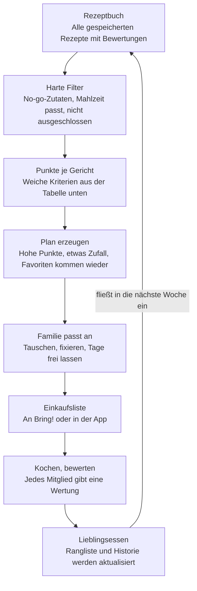
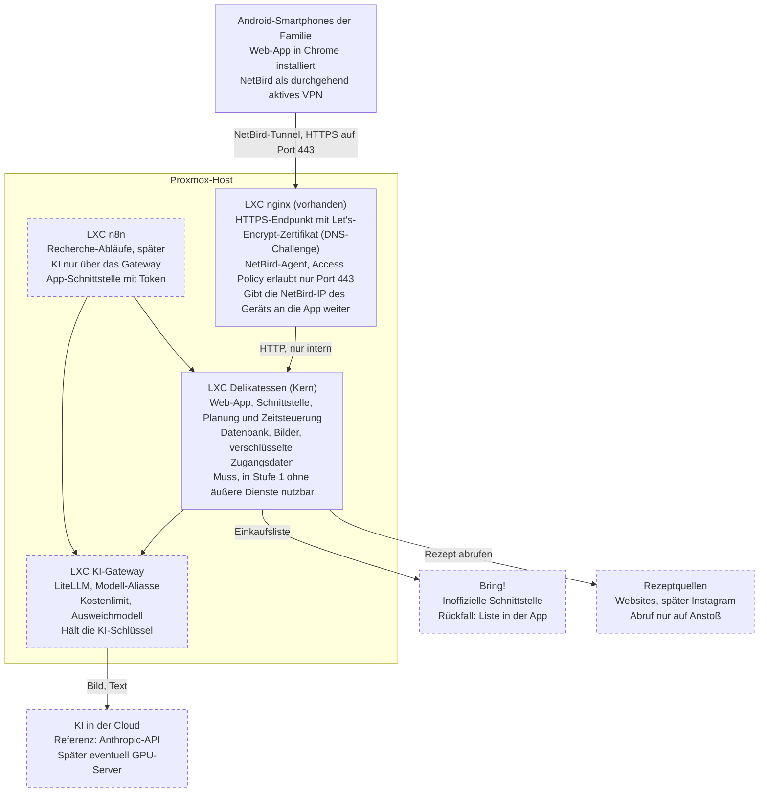
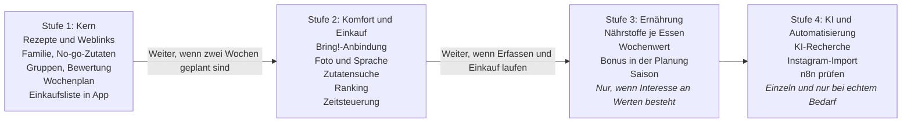

# Delikatessen – Lastenheft

Stand: 2026-11-08

## 1. Ziel und Abgrenzung

Delikatessen erstellt für die Familie automatisch einen Wochenplan aus ihren Lieblingsessen und bringt die Zutaten auf die Einkaufsliste. Die App läuft selbst gehostet in einem LXC-Container auf Proxmox und wird hauptsächlich am Smartphone bedient.

Dieses Lastenheft beschreibt, was die App leisten soll. Technische Hinweise stehen nur dort, wo sie eine Anforderung machbar oder unmöglich machen. Die Entscheidungen zu den diskutierten Punkten stehen in Abschnitt 4.

| Ziel | Woran man es erkennt |
| --- | --- |
| Z1: Wochenplanung kostet kaum noch Zeit | Der Plan entsteht per Knopfdruck und wird nur noch angepasst. |
| Z2: Lieblingsessen entstehen aus dem Alltag | Bewertungen und Kochhistorie ergeben eine Rangliste, ohne dass jemand sie pflegt. |
| Z3: Einkauf schließt direkt an | Die Zutaten der Woche landen mit wenigen Tippern in Bring!. |
| Z4: Daten bleiben in der Familie | Rezepte, Profile und Historie liegen auf dem eigenen Server. |

**Prioritäten:** Muss (ohne das kein Nutzen), Soll (deutlicher Mehrwert), Kann (später oder optional).

**Nicht vorgesehen (Vorschlag):**

- Betrieb für mehrere fremde Haushalte oder Veröffentlichung in App Stores
- Vorratsverwaltung mit Mengen und Haltbarkeitsdaten
- Medizinische Ernährungsberatung, etwa bei Diabetes oder schweren Allergien

## 2. Nutzer und Nutzungssituationen

Ein einzelner Haushalt, dessen Zusammensetzung frei pflegbar ist, nutzt die App gemeinsam, fast immer an Android-Smartphones. Jede Funktion muss deshalb einhändig und auf kleinem Bildschirm bedienbar sein.

| Rolle | Darf |
| --- | --- |
| Erwachsene | Rezepte pflegen, Plan erstellen und ändern, Einkauf auslösen, Familie pflegen |
| Kinder | Vorerst Profil ohne eigenes Gerät, die Eltern bewerten stellvertretend. Perspektivisch selbst bewerten, Wünsche äußern, Plan und Rangliste ansehen |
| Betrieb (eine erwachsene Person) | Updates, Backups, Zugangsdaten für Bring! und KI-Dienste |

**Typische Situationen:**

1. **Vor der Woche:** Plan erzeugen, einzelne Gerichte tauschen, Zutaten an Bring! schicken.
2. **Beim Kochen:** Rezept am Handy lesen, mit passender Portionszahl und Display, das anbleibt.
3. **Nach dem Essen:** Am Tisch mit wenigen Tippern bewerten, für die Kinder vorerst durch die Eltern.
4. **Zwischendurch:** Ein gesehenes Rezept mit Foto, Link oder Sprache festhalten.
5. **Vor dem Verderben:** Nachsehen, was sich mit den vorhandenen Kartoffeln kochen lässt.

## 3. Gesetzte Anforderungen

Der Kern besteht aus Rezeptverwaltung, Lieblingsessen, automatischem Wochenplan und Einkaufsliste. Die Bewertung von Essen steht zwar auf der Diskussionsliste, ist hier aber Muss: Ohne sie können sich keine Lieblingsessen herausbilden.

| ID | Anforderung | Prio |
| --- | --- | --- |
| **Rezepte** | | |
| F-01 | Rezept anlegen, ändern und löschen: Titel, Foto, Portionen, Zutaten mit Menge und Einheit, Zubereitungsschritte, Dauer | Muss |
| F-02 | Zutatenmengen auf eine gewählte Portionszahl umrechnen | Muss |
| F-03 | Rezepte durchsuchen und filtern | Muss |
| F-04 | Kochansicht mit großer Schrift, Display bleibt an | Soll |
| **Lieblingsessen** | | |
| F-10 | Essen nach dem Kochen bewerten, je Familienmitglied | Muss |
| F-11 | Kochhistorie automatisch aus dem Wochenplan führen | Muss |
| F-12 | Lieblingsessen automatisch aus Bewertungen und Häufigkeit ableiten | Muss |
| F-13 | Essen von Hand als Favorit markieren oder von der Planung ausschließen | Muss |
| **Wochenplan** | | |
| F-20 | Wochenplan auf Knopfdruck aus den Lieblingsessen erzeugen | Muss |
| F-21 | Einzelne Gerichte neu vorschlagen lassen, tauschen oder fixieren | Muss |
| F-22 | Tage und Mahlzeiten festlegen, die geplant werden, und einzelne frei lassen | Muss |
| F-23 | Alle Familienmitglieder sehen denselben, aktuellen Plan | Muss |
| F-24 | Planvorschlag donnerstags zu einer einstellbaren Uhrzeit automatisch erzeugen, damit Freitag oder Samstagvormittag eingekauft werden kann, und die Familie benachrichtigen. Die Planwoche läuft von Samstagmittag bis Freitagabend | Soll |
| F-25 | Standardraster: Montag bis Freitag Abendessen, Samstag und Sonntag Mittag- und Abendessen | Muss |
| F-26 | Gerichte sind als Hauptmahlzeit oder kleine Mahlzeit eingeordnet. Am Wochenende plant die App je Tag genau eine Hauptmahlzeit, wahlweise mittags oder abends | Muss |
| F-27 | Gerichte wiederholen sich im Plan, das ist gewollt. Die Planung funktioniert von Anfang an mit wenigen Rezepten und lässt Plätze ohne passendes Gericht frei | Muss |
| **Einkauf** | | |
| F-30 | Einkaufsliste aus dem Plan erzeugen, gleiche Zutaten zusammenfassen | Muss |
| F-31 | Vor dem Übertragen abwählen, was schon im Haus ist | Muss |
| F-32 | Einkaufsliste in der App anzeigen, abhaken und als Text teilen | Muss |
| F-33 | Einkaufsliste an eine gewählte Bring!-Liste übertragen | Soll |
| F-34 | Einkaufsmengen ergeben sich aus einem Portionsfaktor je Person, da kleine Kinder keine ganze Portion essen | Muss |
| **Einstellungen** | | |
| F-40 | Familie in der App pflegen: Personen anlegen und entfernen, Erwachsene oder Kind, No-go-Zutaten, Portionsfaktor | Muss |
| F-41 | Planungsraster, Zeitpunkt des Planvorschlags und KI-Monatsbudget in der App einstellen, ohne Änderung am Server | Muss |

F-32 ist die Rückfallebene, falls die inoffizielle Bring!-Anbindung ausfällt (siehe Abschnitt 7).

## 4. Diskutierte Anforderungen und Entscheidungen

Zehn der 16 Punkte sind übernommen. Sechs kommen später: Saison, Nährstoffe, Ausgewogenheit, Instagram, KI-Recherche und n8n. Die Tabelle ist nach Stufe sortiert.

Zwei Grundlagen tragen mehrere Punkte. Ein **Zutatenkatalog** mit einheitlichen Namen ist Voraussetzung für No-go-Zutaten, Zutatensuche, Saison, Nährwerte und das Zusammenfassen der Einkaufsliste. Ein **gemeinsamer Importweg** endet bei Foto, Sprache, Link und Instagram immer in einer Vorschau, die vor dem Speichern korrigiert wird.

| Thema | Aufwand | Einschätzung | Prio und Stufe | Entscheidung |
| --- | --- | --- | --- | --- |
| Familie, Erwachsene, Kinder, No-go-Zutaten | mittel | Harter Filter in der Planung, Portionen ergeben sich aus der Familie. Verlässlich bei sauber zugeordneten Zutaten. | Muss, Stufe 1 | Übernehmen |
| Gruppierung (Mittag, Snack, vegetarisch, Pasta, Reis ...) | gering | Mehrfach zuweisbare Tags, dazu die Einordnung als Hauptmahlzeit oder kleine Mahlzeit. Die Planung braucht sie für Regeln wie „zweimal vegetarisch pro Woche“. | Muss, Stufe 1 | Übernehmen |
| Bewertung der Essen | gering | Grundlage der Lieblingsessen. Wenige Stufen, kindgerecht und in Sekunden erledigt. | Muss, Stufe 1 | Übernehmen |
| Vorschläge „das hatten wir lange nicht“ | gering | Fällt aus der Kochhistorie fast kostenlos ab und wirkt gegen Eintönigkeit. | Muss, Stufe 1 | Übernehmen |
| Rezepte per Weblink | gering bis mittel | Viele Rezeptseiten liefern strukturierte Daten nach Schema.org. Bei den übrigen hilft eine KI-Auswertung. Schnellster Weg zu einem gefüllten Rezeptbuch. | Muss, Stufe 1 | Übernehmen |
| Rezepte per Foto (direkt in der App) | mittel | KI mit Bildverständnis liefert direkt strukturierte Rezepte und ist klassischer OCR vor allem bei Handschrift überlegen. Bild verlässt den Server, siehe Abschnitt 7. | Soll, Stufe 2 | Übernehmen |
| Rezepte per Sprache | mittel | Gesprochenes wird zu einem strukturierten Rezept. Die technische Umsetzung legt das Pflichtenheft fest. Gut für Familienrezepte, die nirgends aufgeschrieben sind. | Soll, Stufe 2 | Übernehmen |
| Suche nach vorhandenen Zutaten | gering bis mittel | Ohne Vorratsverwaltung: Zutaten eingeben, Rezepte nach Abdeckung sortiert. Auch als „diese Woche verbrauchen“ für die Planung nutzbar. | Soll, Stufe 2 | Übernehmen |
| Ranking und Gamification | gering bis mittel | Rangliste der Gerichte, Essen des Monats, Abzeichen fürs Ausprobieren. Es sollten Gerichte gewinnen, nicht Kinder gegeneinander. | Soll, Stufe 2 | Übernehmen |
| Nährstoffe je Mahlzeit | mittel bis hoch | Der freie Bundeslebensmittelschlüssel passt gut zu deutschen Zutaten. Die Zuordnung von Zutat und Menge kostet die meiste Arbeit, Werte bleiben Schätzungen. | Kann, Stufe 3 | Später |
| Ausgewogenheit pro Woche | mittel | Einfacher Wochenwert nach Lebensmittelgruppen, etwa Gemüse, Fisch, Fleisch. Sieht nur geplante Mahlzeiten, also Orientierung und kein Urteil. | Kann, Stufe 3 | Später |
| Saisonales Gemüse Mitteleuropa | gering | Monatstabelle je Zutat, fließt nur als weiches Kriterium ein. | Kann, Stufe 3 | Später |
| Rezepte aus Instagram | hoch, wartungsintensiv | Keine offizielle Schnittstelle für fremde Beiträge, Download-Werkzeuge brechen regelmäßig. Empfehlung: zuerst Beschreibungstext einfügen oder Screenshot nutzen. | Kann, Stufe 4 | Später |
| KI-Recherche neuer Rezeptideen | mittel | Vorschläge passend zum Geschmacksprofil, landen mit Quelle in einer Eingangsliste. Nichts wird ungeprüft geplant. | Kann, Stufe 4 | Später |
| n8n in eigenem LXC-Container | mittel plus Betrieb | Zeitsteuerung kann die App selbst. n8n lohnt erst, wenn Recherche-Abläufe häufig geändert werden. | Später prüfen, Stufe 4 | Später |
| Choosy als Vorbild für UI und Funktionen | – | Übernehmen als Leitbild: Woche in wenigen Minuten planen, Geschmack lernen, Einkaufsliste entsteht von selbst, Gesundheitswert 1 bis 10. Eigenes Design, keine fremden Inhalte. | Leitbild | Übernehmen |

## 5. Logik des Wochenplans

Harte Kriterien bestimmen, welche Gerichte infrage kommen, weiche bestimmen, welche gewinnen. Die Lieblingsessen entstehen dabei aus der Rückkopplung nach dem Kochen.

**Harte Kriterien (werden nie verletzt):** No-go-Zutaten aller Mitessenden, passende Mahlzeit, von Hand ausgeschlossene Gerichte. Fixierte Gerichte bleiben stehen. Am Wochenende gibt es je Tag genau eine Hauptmahlzeit. Wiederholungen sind gewollt, auch bei großem Rezeptbestand. Findet sich für einen Platz nichts Passendes, bleibt er leer und die App nennt den Grund.

| Weiches Kriterium | Wirkung auf die Punkte | Stufe |
| --- | --- | --- |
| Lieblingsessen | Hohe Familienbewertung bringt die meisten Punkte | 1 |
| Lange nicht gegessen | Punkte steigen mit dem Abstand, kürzlich Gekochtes fällt zurück | 1 |
| Abwechslung in der Woche | Abzug bei gleicher Gruppe, etwa zweimal Pasta | 1 |
| Aufwand | Schnelle Gerichte an festgelegten Tagen bevorzugt | 1 |
| Zutaten verbrauchen | Bonus für Gerichte mit den angegebenen Zutaten | 2 |
| Saison | Bonus für saisonales Gemüse in Mitteleuropa | 3 |
| Neues probieren | Gelegentlich ein selten gekochtes Gericht | 2 |
| Ausgewogenheit | Bonus, wenn der Wochenwert sich verbessert | 3 |

Die Gewichte sind in der App einstellbar (Soll). Jeder Vorschlag nennt seinen Grund, zum Beispiel „lange nicht gegessen“ oder „jetzt Saison“ (Soll).

## 6. Nicht-funktionale Anforderungen

Die App muss ohne Internet, KI und Bring! ihren Kern erfüllen und mit wenig Pflege laufen. Zahlen sind Zielwerte zur Abstimmung.

| ID | Anforderung | Prio |
| --- | --- | --- |
| N-01 | Betrieb als eine Instanz in einem LXC-Container auf Proxmox, Installation reproduzierbar per Skript oder Image | Muss |
| N-02 | Ohne lokale KI-Modelle genügen 2 vCPU und 2 GB RAM | Soll |
| N-03 | Tägliches Backup von Datenbank und Bildern, Wiederherstellung dokumentiert und einmal getestet | Muss |
| N-04 | Zugriff nur über HTTPS. Kamera, Mikrofon und Installation auf dem Startbildschirm setzen das im Browser voraus | Muss |
| N-05 | Bedienung als Web-App (PWA), für Android-Smartphones entworfen, einhändig nutzbar, auf den Startbildschirm installierbar, Ziel im Teilen-Menü, Sprache Deutsch | Muss |
| N-06 | Keine App-Store-Installation nötig | Muss |
| N-07 | Plan und Rezepte der Woche bleiben ohne Empfang lesbar | Soll |
| N-08 | Wochenplan entsteht in unter 3 Sekunden, Importe zeigen Fortschritt und dürfen bis 60 Sekunden dauern | Soll |
| N-09 | Eigenes Profil je Familienmitglied, ohne Passwort: Den Zugriffsschutz übernimmt NetBird. Das Gerät merkt sich das gewählte Profil (oder es wird über die NetBird-IP zugeordnet), Eltern können für die Kinder-Profile bewerten | Muss |
| N-10 | Keine Freigabe ins Internet, Zugriff nur über das NetBird-VPN. Zugangsdaten für Bring! und KI nur serverseitig und verschlüsselt | Muss |
| N-11 | An externe Dienste gehen nur die nötigen Rezeptdaten, keine Namen, Alter oder Unverträglichkeiten von Familienmitgliedern | Muss |
| N-12 | Bring!, KI-Dienste und n8n sind abschaltbar. Fällt einer aus, bleiben Rezepte, Plan und Liste nutzbar | Muss |
| N-13 | Export aller Rezepte in einem offenen Format | Soll |
| N-14 | Updates ohne Datenverlust, Datenbank wird automatisch migriert | Muss |
| N-15 | Quellcode öffentlich in einem Repository im GitHub-Konto kallelix, Lizenz MIT | Muss |
| N-16 | Keine Zugangsdaten, Schlüssel, Domains oder Familiendaten im Repository. Konfiguration nur über Umgebungsvariablen oder eine nicht eingecheckte Datei, mit Beispieldatei im Repository | Muss |

## 7. Schnittstellen und externe Quellen

Bring! und Instagram bieten für diesen Zweck keine verlässliche offizielle Anbindung. Beide werden deshalb so eingebaut, dass ein Ausfall den Kern nicht berührt.

Gestrichelt: optional und abschaltbar (N-12).

Stand der Recherche: 2026-11-08

| System | Feststellung | Folge für Delikatessen |
| --- | --- | --- |
| Zugang (NetBird und nginx) | NetBird bietet offizielle Android-Apps, die Anmeldung erfolgt einmal pro Gerät, danach läuft es als durchgehend aktives VPN. Ein nginx-Container ist bereits vorhanden und kann als HTTPS-Endpunkt dienen. | Keine Freigabe ins Internet. NetBird-Agent im nginx-Container, Access Policy nur für Port 443. Zertifikat per Let's Encrypt mit DNS-Challenge auf eigener Domain, intern HTTP zur App. Statt Login nur Profilauswahl oder Zuordnung über die NetBird-IP des Geräts. |
| Bring! | Eine offizielle, frei nutzbare API war nicht zu finden. Das Paket [bring-api](https://pypi.org/project/bring-api/) ist inoffiziell, wird von Home Assistant genutzt und meldet sich mit E-Mail und Passwort an. Mengen gehen nur als freier Zusatztext. Der [Bring! Import Button](https://www.getbring.com/de/rezeptepartner) richtet sich an Rezeptpartner mit [Schema.org- oder JSON-LD-Rezepten](https://www.getbring.com/de/integration-prufen). | Eigener Bring!-Nutzer für die App als Mitglied der gemeinsamen Liste der Eltern. Anbindung austauschbar kapseln, Menge als Zusatztext senden, Fehler sichtbar melden. F-32 bleibt Rückfallebene. |
| Instagram | Die [offizielle Plattform](https://developers.facebook.com/docs/instagram-platform/) richtet sich an Inhaber eigener Business- und Creator-Konten. Ein Lesen fremder Reels war in der Übersicht nicht zu finden. Laut [Testbericht zu Social-to-Mealie](https://unsubbed.pages.dev/tools/social-to-mealie/) bricht der Video-Download per yt-dlp wiederholt, und Cookies laufen ab. | Zuerst Text einfügen und Screenshot über den normalen Importweg. Automatischer Abruf nur als Kann, Nutzungsbedingungen vorher prüfen. |
| Teilen-Menü am Smartphone | Web-Apps können auf dem iPhone nicht als Teilen-Ziel dienen, der [WebKit-Eintrag](https://bugs.webkit.org/show_bug.cgi?id=194593) ist seit 2019 offen. Unter Android geht es mit installierter Web-App. | Alle Geräte der Familie sind Android: Die installierte Web-App wird direktes Teilen-Ziel, ein iPhone-Umweg ist nicht nötig. |
| Nährwerte | Der [Bundeslebensmittelschlüssel 4.0](https://heise.de/-11123877) ist kostenfrei und enthält 7.140 Lebensmittel und Gerichte mit bis zu 138 Nährstoffen. | Vor Stufe 3 Lizenzbedingungen und Downloadformat prüfen. Regeln für den Wochenwert aus der aktuellen DGE-Veröffentlichung übernehmen. |
| KI-Dienste | Lokal gibt es keine GPU. Referenzimplementierung ist die Anthropic-API mit Monatsbudget. Ein eigener GPU-Server in der Cloud mit OpenAI-kompatibler Schnittstelle kann später ergänzt werden, die Entscheidung dazu ist vertagt. Ein KI-Gateway wie [LiteLLM](https://docs.litellm.ai/) bindet beide hinter einer einheitlichen Schnittstelle an, mit Modell-Aliassen, Ausweichmodellen und Kostenlimits. | Eigener Container als einzige Stelle für Modelle und KI-Schlüssel. Die App kennt nur feste Aufgaben (Rezept aus Foto, Text oder Sprache) mit festem Antwortformat und ruft dazu Aliasse am Gateway auf. Ob ein Alias zu Anthropic oder zum GPU-Server führt, ist reine Konfiguration, auch als Ausweichweg. Links zuerst ohne KI über schema.org-Daten auslesen. Jedes Ergebnis erscheint als Vorschau vor dem Speichern, das Monatsbudget ist ein Limit im Gateway, seine Höhe ist in der App einstellbar. |
| n8n | Bewertung siehe Abschnitt 4. | Falls eingeführt: eigener Container nur für mehrstufige Abläufe im Hintergrund (KI-Recherche, Instagram-Abruf). Nutzt für KI ebenfalls das Gateway und schreibt nur über die App-Schnittstelle mit eigenem Token. Der Import, bei dem jemand am Handy wartet, läuft nicht über n8n. |
| [Choosy](https://www.choosy.de/) (Vorbild) | Die Website wirbt mit Wochenplanung in 3 Minuten, KI-Vorschlägen nach Geschmack, automatischer Einkaufsliste und einem Health Score von 1 bis 10. Vorratsmanager und detaillierte Nährwerte sind Premium. | Nur loses Vorbild ohne konkrete Vorgaben, eigenes Design und eigene Inhalte. |

## 8. Ausbaustufen

Vier Stufen liefern jeweils einen eigenen Nutzen, und die riskanten Fremdabhängigkeiten kommen zuletzt. Stufe 1 braucht weder KI noch Bring!, sondern nur Rezepte, die Familie und einen Plan.

Weblinks stehen in Stufe 1, weil der Rezeptbestand im Betrieb wächst und ein schneller Import dafür besonders wichtig ist. Termine werden erst im Pflichtenheft festgelegt.
