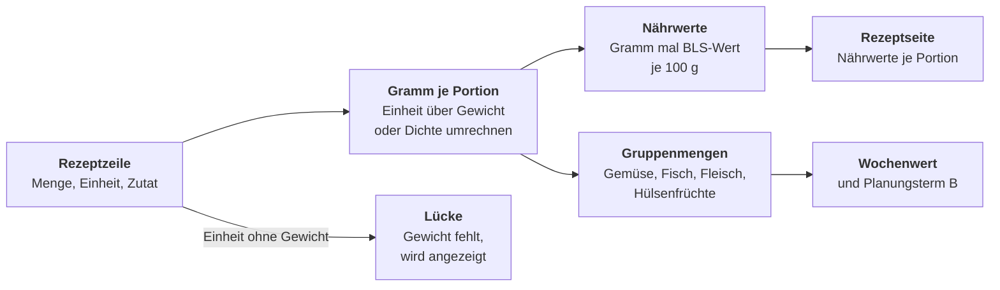
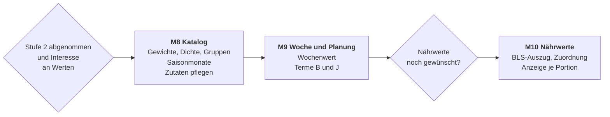

# Delikatessen – Pflichtenheft Stufe 3 (Entwurf)

Stand: 2026-11-13 · Entwurf, nicht freigegeben

## 1. Überblick und Umfang

Dieses Dokument ergänzt das [Pflichtenheft](pflichtenheft.md) um Stufe 3 „Ernährung“ aus dem [Lastenheft](lastenheft.md). Es gilt erst nach Freigabe. Stufe 3 beginnt laut Lastenheft nur, wenn Erfassen und Einkauf im Alltag laufen und die Familie Interesse an Werten hat.

| Kürzel | Wunsch aus dem Lastenheft | Festgelegt in |
| --- | --- | --- |
| D-NAEHR | Nährstoffe je Mahlzeit | Abschnitt 5 |
| D-AUSG | Ausgewogenheit pro Woche, mit Bonus in der Planung | Abschnitte 6 und 7 |
| D-SAIS | Saisonales Gemüse Mitteleuropa, als weiches Kriterium | Abschnitte 4 und 7 |

**Grundsatz:** Alle Werte sind Orientierung und kein Urteil. Die App sieht nur geplante Mittag- und Abendessen, nicht Frühstück, Snacks oder Kantine. Deshalb gibt es keine Tagessummen, keine Werte je Person und keine Ampeln.

**Abschaltbar:** Ein Schalter „Ernährung“ in den Einstellungen (Vorgabe aus) blendet Nährwerte, Wochenwert und die beiden neuen Planungsterme ein. Ist er aus, verhält sich die App genau wie in Stufe 2.

**Nicht enthalten:** Vorratsverwaltung, Kalorienzählen je Person, Empfehlungen für Kinder, Mikronährstoffe wie Vitamine und Mineralstoffe.

## 2. Ergebnis der Vorprüfung

Das Lastenheft verlangt vor Stufe 3, die Lizenzbedingungen und das Downloadformat zu prüfen (Abschnitt 7, Nährwerte). Ergebnis vom 13.11.2026:

| Quelle | Befund | Folge |
| --- | --- | --- |
| [Bundeslebensmittelschlüssel 4.0](https://www.blsdb.de/download) | Open Data unter [CC BY 4.0](https://creativecommons.org/licenses/by/4.0/legalcode), kostenlos und ohne Registrierung, Max Rubner-Institut als Herausgeber zu nennen. Eine XLSX-Datei mit 7.140 Lebensmitteln und 138 Nährstoffen, alle Werte je 100 g essbaren Anteil, Bezeichnungen auf Deutsch und Englisch. Fehlende Werte sind leer und nicht 0. Errata vom August 2026 kommen erst mit Version 4.1 | Ein Auszug darf ins Repo, mit eigenem Lizenzvermerk für die Daten (Abschnitt 9) |
| DGE „Gut essen und trinken“ (2024) | [Orientierungswerte](https://www.dge.de/gesunde-ernaehrung/gut-essen-und-trinken/dge-ernaehrungskreis/) je Lebensmittelgruppe für Erwachsene, ausdrücklich als Wochenbilanz gedacht. Die Grafik des Ernährungskreises braucht eine Lizenz, die eine Weitergabe ausschließt. Für die Zahlen gibt es keine eigene Regel | Nur wenige Zahlen als änderbare Vorgaben mit Quellenangabe, keine Grafik, kein Logo, keine Aussage „nach DGE geprüft“ |
| Optimierte Mischkost für Kinder (FKE, 2025) | Mengen je Altersgruppe, Lizenz CC BY-NC-ND 4.0 | Nicht verwendet. Werte je Person sind ohnehin nicht vorgesehen |
| Saisonkalender von BLE/BZfE und Verbraucherzentrale | Nutzung nur mit Zustimmung bzw. CC BY-NC-ND. Eine frei lizenzierte Monatstabelle gibt es nicht | Eigene Tabelle für den Grundkatalog, nicht aus einer fremden Tabelle abgeschrieben (Abschnitt 4) |

**Stolperstein BLS-Gruppen:** Der erste Buchstabe des BLS-Codes ist die Hauptgruppe, passt aber nicht zu den DGE-Gruppen. So steht „Kichererbse reif“ unter G (Gemüse) und nicht unter H (Hülsenfrüchte). Die Lebensmittelgruppe für den Wochenwert ist deshalb ein eigenes Feld der Zutat und wird nicht aus dem Code abgeleitet.

## 3. Ablauf der Berechnung

Alle drei Funktionen hängen an zwei Angaben je Rezeptzeile: Gewicht in Gramm und Zutat aus dem Katalog. Die Nährwerte brauchen zusätzlich die BLS-Zuordnung, der Wochenwert nur die Lebensmittelgruppe.

**Vom Rezept zur Mahlzeit, mit Lücken sichtbar statt geschätzt.**



## 4. Datenmodell

Die Erweiterung sitzt fast vollständig am Zutatenkatalog, wie im Pflichtenheft Abschnitt 4 vorgesehen („später Saison, BLS-Code“). Eine Migration `0004_ernaehrung` ergänzt:

| Tabelle | Neue Felder | Bedeutung |
| --- | --- | --- |
| `ingredient` | `bls_code` | Zuordnung zu einem BLS-Lebensmittel, möglichst die rohe Form. Leer heißt: keine Nährwerte |
| `ingredient` | `food_group` | Gruppe für den Wochenwert: Gemüse, Obst, Hülsenfrüchte, Nüsse, Kartoffeln, Getreide, Milch, Fisch, Fleisch, Wurst, Eier, Fett, Sonstiges |
| `ingredient` | `density` | Gramm je Milliliter, Vorgabe 1,0, etwa Öl 0,92 und Honig 1,4 |
| `ingredient` | `season_months` | Monate mit Ernte aus der Region, leer für ganzjährig oder Lagerware |
| `ingredient_unit_weight` (neu) | `ingredient_id`, `unit`, `grams` | Gewicht einer Einheit, etwa Zwiebel Stück 80 g oder Petersilie Bund 30 g |
| `bls_food` (neu) | `code`, `name`, acht Nährwerte | Auszug aus dem BLS, beim Start aus der Datei im Repo geladen, wenn sich die Version geändert hat |

**Umrechnung in Gramm** in dieser Reihenfolge:

1. g und kg direkt, ml, cl, dl und l über die Dichte der Zutat.
2. Gewicht aus `ingredient_unit_weight` für genau diese Zutat und Einheit.
3. Allgemeine Rückfallwerte nur für Löffelmaße: EL 15 ml, TL 5 ml, Msp. und Prise 0,5 g, jeweils mal Dichte.
4. Sonst bleibt die Zeile eine Lücke. Zeilen ohne Menge („Salz nach Geschmack“) zählen weder als Wert noch als Lücke.

**Grundkatalog:** Die 146 Zutaten in `katalog.json` bekommen BLS-Code, Lebensmittelgruppe, Dichte wo nötig und ein Gewicht für jede Standard-Einheit, die nicht g oder ml ist. Heute sind das 68 Zutaten, etwa mit Stück, EL oder Bund. Die Gewichte sind eigene Durchschnittswerte, der BLS enthält keine Stückgewichte.

**Saisontabelle:** Eigene Monatsangaben für die Zutaten der Gruppen Gemüse, Obst und Kräuter im Grundkatalog. Sie entstehen im Projekt aus allgemeinem Wissen und werden von der Familie gegengelesen. Sie werden nicht aus einer der Tabellen in Abschnitt 2 übernommen. Lagerware wie Kartoffeln, Zwiebeln und Äpfel bleibt ohne Angabe und ist damit neutral.

**Lernen wie bei Aliassen:** Fehlt ein Gewicht, ergänzt ein Erwachsener es mit einem Tipp an der Lücke. Es gilt dann für alle Rezepte mit dieser Zutat und Einheit.

## 5. Nährwerte je Mahlzeit (D-NAEHR)

Die Rezeptseite zeigt einen Block „Nährwerte je Portion (Schätzung)“ mit den Angaben der üblichen Nährwerttabelle. Die Werte rechnen mit den Portionen des Rezepts, unabhängig vom Portionsregler.

| Anzeige | BLS-Code | Einheit |
| --- | --- | --- |
| Energie | `ENERCC` | kcal |
| Eiweiß | `PROT625` | g |
| Fett | `FAT` | g |
| davon gesättigte Fettsäuren | `FASAT` | g |
| Kohlenhydrate | `CHO` | g |
| davon Zucker | `SUGAR` | g |
| Ballaststoffe | `FIBT` | g |
| Salz | `NACL` | g |

**Regeln:**

- Wert je Portion ist die Summe aus Gramm mal Wert je 100 g, geteilt durch die Portionen des Rezepts. Gerundet wird auf 10 kcal und auf 1 g, Salz auf 0,1 g.
- Garverluste und Zubereitung werden nicht berücksichtigt. Die Zutaten gelten als roh, so wie sie im Rezept stehen.
- Unter dem Block steht die Abdeckung, etwa „berechnet aus 8 von 10 Zutaten“. Ein Tipp öffnet die Liste der Lücken mit „Gewicht ergänzen“ oder „BLS zuordnen“.
- Fehlt ein Wert im BLS, wird diese Zutat für diesen Nährwert nicht gezählt, und der Wert ist mit „unvollständig“ markiert. Im Auszug betrifft das höchstens 53 von 7.140 Lebensmitteln (Ballaststoffe).
- Im Plan zeigt das Aktionsmenü eines Platzes die Energie je Portion als Zusatzzeile. Summen über Tage oder die Woche gibt es nicht.

**Zuordnung neuer Zutaten zum BLS:** Beim Bearbeiten einer Zutat schlägt eine Suche im Auszug passende Einträge vor. Einträge mit „roh“ und kürzere Namen stehen dabei oben. Die Zuordnung ist freiwillig: Ein Rezept bleibt ohne sie planbar, anders als bei der Katalogzuordnung für No-gos.

## 6. Ausgewogenheit pro Woche (D-AUSG)

Unter dem Wochenplan steht eine Karte „Woche im Überblick“ mit wenigen Regeln. Gezählt werden alle Plätze der Woche, die nicht entfallen sind, mit der Rezeptmenge je Portion.

| Regel | Zählt | Vorgabe | Herleitung |
| --- | --- | --- | --- |
| Fisch | Mahlzeiten mit mindestens 60 g Fisch je Portion | 1 bis 2 | DGE: 1–2 Portionen à 120 g je Woche. Halbe Portion als Schwelle, weil Fisch in Gerichten oft anteilig vorkommt |
| Fleisch und Wurst | Summe in Gramm je Portion | höchstens 300 g | DGE: höchstens 300 g je Woche |
| Hülsenfrüchte | Mahlzeiten mit mindestens 50 g Hülsenfrüchten je Portion | mindestens 1 | DGE: 1 × 125 g verzehrfertig je Woche, das sind etwa 70 g getrocknet |
| Gemüse | Hauptmahlzeiten mit mindestens 110 g Gemüse je Portion | alle | DGE: Portion Obst oder Gemüse à 110 g. Die Regel „jede Hauptmahlzeit“ ist eine eigene Ableitung |
| Vegetarisch | Mahlzeiten ohne Fisch, Fleisch und Wurst | nur Anzeige | – |

**Darstellung:** Neutrale Sätze statt Farben, etwa „Fisch: 1 Mahlzeit (Orientierung 1–2)“ oder „Fleisch und Wurst: 240 g je Portion (Orientierung höchstens 300 g)“. Unter der Karte steht der Hinweis, dass nur geplante Mahlzeiten zählen, dazu ein Link zur Quelle.

**Lücken:** Hat ein Rezept Zeilen ohne Gewicht, zählt es mit dem bekannten Teil. Die Karte nennt dann „ohne 3 Zutaten ohne Gewicht“.

**Einstellbar:** Schwellen und Vorgaben stehen in den Einstellungen, vorbelegt wie oben.

## 7. Erweiterung der Planung

Zwei Terme ergänzen die Formel aus Pflichtenheft Abschnitt 6 und [betrieb.md Abschnitt 11](betrieb.md), jeweils mit eigenem Gewicht. Sie wirken nur bei eingeschaltetem Schalter „Ernährung“ und sind weiche Kriterien. Harte Regeln bleiben unverändert.

```math
S(r,p) = \ldots + w_V \, V(r) + w_N \, N(r) + w_B \, B(r,W) + w_J \, J(r,p)
```

| Größe | Bedeutung | Berechnung | Gewicht (Vorgabe) |
| --- | --- | --- | --- |
| B | Ausgewogenheit | Summe der Beiträge, begrenzt auf −1 bis 1. Fisch +1, solange das Minimum der Woche nicht erreicht ist. Hülsenfrüchte +1, solange das Minimum nicht erreicht ist. Gemüse +0,5 für eine Hauptmahlzeit, die die Gemüseregel erfüllt. Fisch −1, wenn das Maximum schon erreicht ist. Fleisch und Wurst −1, wenn das Rezept die Obergrenze überschreiten würde | 0,20 |
| J | Saison | Anteil der Zutaten mit Saisonangabe, die im Monat des Platzes Saison haben. Rezepte ohne solche Zutaten bekommen 0,5 | 0,10 |

B wird wie A und V nach jeder Wahl neu berechnet. Fixierte Plätze zählen von Anfang an mit. Der Grund am Platz lautet dann etwa „bringt Fisch in die Woche“, „Hülsenfrüchte fehlen noch“ oder „Saison: Spargel“.

**Rückwärtsverträglich:** Mit w_B = w_J = 0 oder abgeschaltetem Schalter entstehen bei gleichem Zufallswert genau die Pläne aus Stufe 2.

## 8. Oberfläche und Schnittstellen

| Ort | Ergänzung |
| --- | --- |
| Rezeptseite | Block „Nährwerte je Portion (Schätzung)“ mit Abdeckung und Lücken |
| Woche | Karte „Woche im Überblick“ unter dem Plan, Energie im Aktionsmenü des Platzes |
| Mehr › Zutaten pflegen (neu, nur Erwachsene) | Liste der Zutaten ohne Gewicht, BLS-Code oder Gruppe, sortiert nach Zahl der planbaren Rezepte. Bearbeiten von Gruppe, Aliassen, Gewichten, Dichte, Saisonmonaten und BLS-Zuordnung |
| Mehr › Einstellungen | Schalter „Ernährung“, Gewichte B und J, Schwellen und Vorgaben des Wochenwerts |
| Mehr › Über | Quellenangabe des BLS nach Abschnitt 9 |

| Bereich | Endpunkte | Hinweis |
| --- | --- | --- |
| Katalog | `PUT /ingredients/{id}`, `GET /ingredients/gaps` | PUT fehlt heute ganz und ist nur für Erwachsene |
| BLS | `GET /bls?q=` | Suche im Auszug für die Zuordnung |
| Nährwerte | `GET /recipes/{id}/nutrition` | Werte je Portion, Abdeckung, Lücken |
| Wochenwert | `GET /plans/{start}/balance` | Regeln mit Zählung und Vorgabe |

**Sichtbarkeit:** Nährwerte, Wochenwert und die Gründe am Platz sehen alle Profile gleich, auch Kinder. Nur „Zutaten pflegen“ und die Einstellungen sind Erwachsenen vorbehalten.

## 9. Lizenzen und Quellenangaben

| Inhalt | Umgang |
| --- | --- |
| BLS-Auszug | Datei `backend/delikatessen/data/bls_4_0_auszug.json.gz` mit Code, Name und den acht Nährwerten aller 7.140 Lebensmittel, etwa 210 KB. Ein Skript im Repo erzeugt sie aus der offiziellen XLSX-Datei, ohne zusätzliche Abhängigkeit. Daneben liegt `BLS-LIZENZ.md` mit Zitierweise, Lizenz-URL und dem Änderungshinweis „Auszug, Spalten reduziert, in JSON umgewandelt“. Die README nennt die Ausnahme von der MIT-Lizenz |
| Zitierweise | „Max Rubner-Institut (2025): Bundeslebensmittelschlüssel (BLS), Version 4.0 – Deutsche Nährstoffdatenbank. Karlsruhe. DOI: 10.25826/Data20251217-134202-0“, in der App unter „Über“ und in `BLS-LIZENZ.md` |
| DGE | Nur die Zahlen aus Abschnitt 6 als änderbare Vorgaben mit Link zur Quelle. Keine Grafik, kein Logo, keine Formulierung, die eine Prüfung oder Empfehlung der DGE nahelegt |
| Saison | Eigene Tabelle unter der MIT-Lizenz des Projekts |

**Update auf BLS 4.1:** Das Skript neu ausführen, die Version in der Datei erhöhen und die Zuordnungen des Grundkatalogs per Test prüfen. Gelöschte Codes vergibt das MRI nicht neu, deshalb kann ein veralteter Code nie zu einem falschen Lebensmittel führen.

## 10. Abnahme

| ID | Abnahmekriterium | Stufe |
| --- | --- | --- |
| AK-30 | Jede Zutat des Grundkatalogs hat eine Lebensmittelgruppe. Jede Zutat der Gruppen Gemüse, Obst, Fleisch, Fisch und Meeresfrüchte, Hülsenfrüchte, Milchprodukte, Käse, Eier, Nüsse, Getreide und Teigwaren sowie Öle und Fette hat einen gültigen BLS-Code und ein Gewicht für ihre Standard-Einheit | 3 |
| AK-31 | Für ein festes Testrezept weichen alle acht Nährwerte je Portion höchstens 1 % von einer Handrechnung mit denselben BLS-Werten ab | 3 |
| AK-32 | Von 10 echten Familienrezepten haben mindestens 8 nach dem Ergänzen der vorgeschlagenen Gewichte höchstens eine Lücke | 3 |
| AK-33 | Eine feste Testwoche ergibt die erwarteten Zählungen für Fisch, Fleisch und Wurst, Hülsenfrüchte, Gemüse und Vegetarisch. Entfallene Plätze zählen nicht | 3 |
| AK-34 | Bei 1.000 Plänen mit festem Rezeptbestand enthält mit w_B = 0,20 mindestens 90 % der Wochen eine Fischmahlzeit und höchstens 5 % mehr als 300 g Fleisch und Wurst. Mit w_B = 0 wird der Vergleichswert gemessen und im Test festgehalten | 3 |
| AK-35 | Mit abgeschaltetem Schalter „Ernährung“ entstehen bei gleichem Zufallswert dieselben Pläne wie in Stufe 2, und die App zeigt keine Nährwerte | 3 |
| AK-36 | Ein Spargelrezept hat im Mai J = 1 und im Dezember J = 0, ein Rezept ohne Saisonzutaten 0,5 | 3 |
| AK-37 | AK-01 gilt weiter: 9 Plätze bei 200 Rezepten in unter 3 Sekunden, mit beiden neuen Termen | 3 |
| AK-38 | Die Quellenangabe des BLS steht in der App und im Repo, `BLS-LIZENZ.md` liegt neben dem Auszug | 3 |

## 11. Umsetzungsplan

Die Meilensteine ohne fremde Daten kommen zuerst. Nach M9 entscheidet die Familie, ob M10 noch gebraucht wird.



| Risiko | Folge | Gegenmaßnahme |
| --- | --- | --- |
| Gewichte fehlen bei vielen Zutaten | Werte bleiben lückenhaft | Gewichte für den ganzen Grundkatalog vorab, Ergänzen mit einem Tipp, Liste „Zutaten pflegen“ nach Häufigkeit |
| Werte wirken genauer, als sie sind | Falsche Sicherheit | Überall „Schätzung“, Abdeckung sichtbar, Rundung, keine Tagessummen |
| Wochenwert wird als Urteil gelesen | Druck statt Hilfe, besonders bei Kindern | Neutrale Sätze, keine Farben, keine Werte je Person, abschaltbar |
| BLS 4.1 ändert Codes | Zuordnungen veralten | Test gegen den Grundkatalog beim Update, gelöschte Codes werden nicht neu vergeben |
| Rechtliche Unsicherheit bei DGE-Zahlen | Nachfrage der DGE | Nur wenige Zahlen mit Quelle, änderbar, ohne Grafik und Logo. Bei Bedarf Anfrage an die DGE |

## 12. Entscheidungen

Am 13.11.2026 geklärt:

| Frage | Entscheidung |
| --- | --- |
| Sehen Kinderprofile Nährwerte und Wochenwert? | Ja, alle Profile sehen dasselbe (Abschnitt 8) |
| Welche Nährwerte? | Die acht Werte der üblichen Nährwerttabelle (Abschnitt 5) |
| Bremst die Fleisch-Obergrenze die Planung? | Ja, über Term B (Abschnitt 7) |
| Wer liest Saisontabelle und Stückgewichte gegen? | Kristian, vor Abschluss von M8 |

## 13. Rückverfolgung

| Anforderung | Abschnitt | Prüfung |
| --- | --- | --- |
| D-NAEHR | 4, 5, 9 | AK-30, AK-31, AK-32, AK-38 |
| D-AUSG | 4, 6, 7 | AK-33, AK-34, AK-35, AK-37 |
| D-SAIS | 4, 7 | AK-36, AK-37 |
