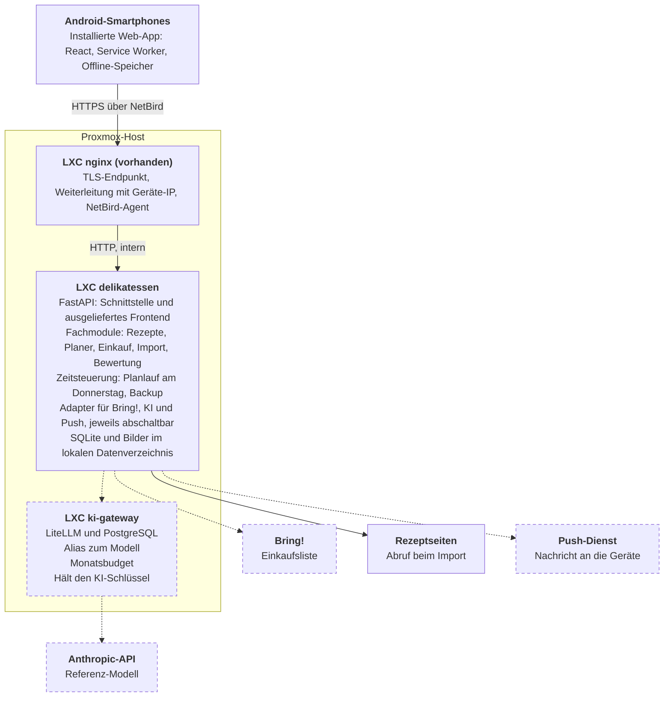
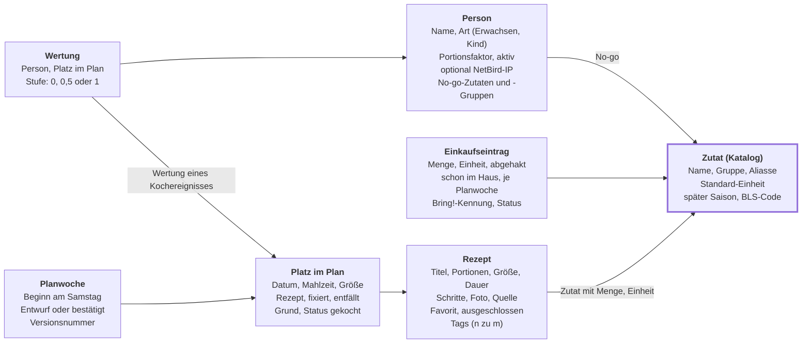
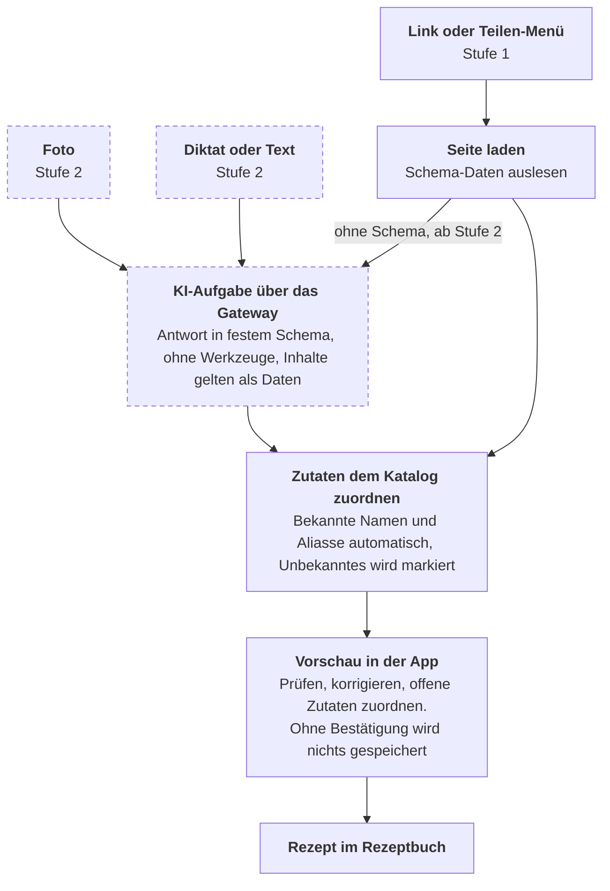
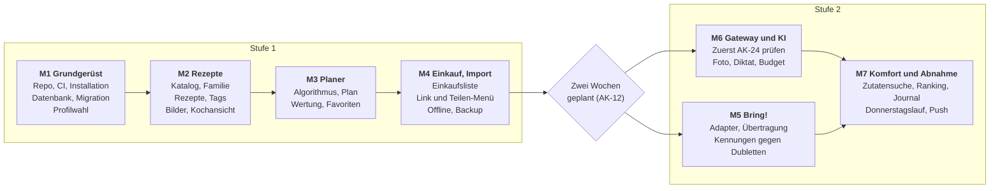

# Delikatessen – Pflichtenheft

Stand: 2026-11-08 · Freigegeben: 2026-11-11

## 1. Überblick und Umfang

Dieses Pflichtenheft legt fest, wie Delikatessen die Anforderungen aus dem [Lastenheft](lastenheft.md) umsetzt. Stufe 1 und 2 sind vollständig spezifiziert. Stufe 3 und 4 werden nur so weit berücksichtigt, dass sie später ohne Umbau möglich sind.

| Stufe | Liefert | Benötigt von außen |
| --- | --- | --- |
| 1: Kern | Rezepte, Import per Link und Teilen-Menü (nur strukturierte Seiten), Familie und No-go-Zutaten, Bewertung, Wochenplan, Einkaufsliste in der App | nichts außer vorhandenem nginx und NetBird |
| 2: Komfort und Einkauf | Bring!, Import per Foto und Sprache, KI-Auswertung bei unstrukturierten Links, Zutatensuche, Ranking, automatischer Planvorschlag mit Benachrichtigung, Journal vergangener Wochen | KI-Gateway, Anthropic-API, Bring! |

**Klarstellung zum Lastenheft:** Die KI-Auswertung bei Weblinks beginnt erst in Stufe 2, weil Stufe 1 ohne KI laufen soll. Das Teilen-Menü für Links kommt schon in Stufe 1, weil es den Rezeptbestand am schnellsten aufbaut.

**Nicht enthalten:** Saison, Nährstoffe, Ausgewogenheit, Instagram, KI-Recherche und n8n. Der Zutatenkatalog und die Planungsformel sind so angelegt, dass sich diese Punkte ergänzen lassen.

## 2. Technische Entscheidungen

Delikatessen wird eine einzelne Python-Anwendung mit SQLite und einer installierbaren Web-App. Python ergibt sich aus den beiden wichtigsten Bibliotheken für Bring! und Rezept-Import. Das KI-Gateway kommt erst in Stufe 2 dazu und ist der einzige ressourcenhungrige Teil.

| Bereich | Festlegung | Begründung | Alternative |
| --- | --- | --- | --- |
| Backend | Python 3.12, FastAPI | Passt zu `bring-api` und `recipe-scrapers`, das [Python ab 3.11](https://pypi.org/project/recipe-scrapers/) verlangt | Node, dann fehlt der gepflegte Rezept-Parser |
| Datenbank | SQLite im WAL-Modus, SQLAlchemy, Alembic | Ein Haushalt, ein Prozess, Backup ist eine Datei, Migrationen automatisch (N-14) | PostgreSQL, unnötiger Betrieb |
| Hintergrundjobs | APScheduler im App-Prozess, Importe als Datensätze in der Datenbank | Donnerstagslauf und Importe brauchen keine Warteschlange | n8n, bewusst später |
| Frontend | React, TypeScript, Vite, [vite-plugin-pwa mit injectManifest](https://vite-pwa-org.netlify.app/guide/inject-manifest.html) | Eigener Service Worker ist nötig für Teilen-Ziel, Push und Offline | Vue, gleichwertig |
| Rezept-Import | [recipe-scrapers](https://pypi.org/project/recipe-scrapers/) (MIT), HTML holt die App selbst | Wertet Schema-Markup aus, kein eigener Parser | KI für jede Seite, teurer |
| Bring! | [bring-api](https://pypi.org/project/bring-api/), Version fest gepinnt, hinter eigener Schnittstelle | Inoffiziell, kann brechen, deshalb austauschbar | keine |
| KI-Zugriff | Offizielles Anthropic-SDK für Python, `base_url` zeigt auf den [`/v1/messages`-Endpunkt des Gateways](https://docs.litellm.ai/docs/anthropic_unified) | Einheitliche Schnittstelle, Modellwechsel nur in der Gateway-Konfiguration | Direkt zur Anthropic-API, dann ohne Budget im Gateway |
| KI-Modell | Alias `rezept-extraktion` auf `claude-opus-5-5` | Startwert mit der höchsten Qualität, Kosten siehe Abschnitt 7 | Sonnet oder Haiku, nur Alias ändern |
| KI-Gateway | LiteLLM im Docker-Image, Version gepinnt, eigener LXC mit Docker und PostgreSQL | [Budgets brauchen eine Datenbank](https://docs.litellm.ai/docs/proxy/users), das Image war vom [PyPI-Angriff im März 2026](https://docs.litellm.ai/blog/security-update-march-2026) nicht betroffen | Budget in der App, dann entfällt der Gateway-Container |
| Sprache | Diktat im Browser ([Web Speech API](https://developer.mozilla.org/en-US/docs/Web/API/Web_Speech_API/Using_the_Web_Speech_API)), Rückfall Mikrofon der Android-Tastatur | Kein Audio auf dem eigenen Server, kein Transkriptionsdienst nötig | Whisper auf GPU-Server, später |
| Benachrichtigung | [Web Push](https://developer.mozilla.org/en-US/docs/Web/API/Push_API) mit VAPID | Kommt ohne Freigabe ins Internet aus, nur ausgehende Verbindung | keine |
| Installation | App direkt im LXC mit systemd und Installationsskript, Docker nur im Gateway-LXC | Proxmox [empfiehlt für verschachtelte Container bei hoher Isolation eine VM](https://pve.proxmox.com/wiki/Linux_Container), daher so wenig Docker wie möglich | Docker überall |

**Folge für den Host:** LiteLLM nennt [1 vCPU und mindestens 4 GB RAM](https://docs.litellm.ai/docs/proxy/prod) je Instanz. Das Gateway braucht damit doppelt so viel Speicher wie die App mit ihren 2 GB aus N-02. Der Host hat dafür genug Reserve.

## 3. Systemarchitektur

Die App ist ein einzelner Prozess mit klar getrennten Fachmodulen. Jeder äußere Dienst sitzt hinter einem eigenen Adapter und kann ausfallen, ohne den Kern zu berühren (N-12).

**Alle Zugriffe laufen über nginx, KI nur über das Gateway.**



Gestrichelt: abschaltbar, Stufe 1 läuft ohne Gateway, Bring!, KI und Push.

Die Web-App speichert den aktuellen Plan und dessen Rezepte im Service Worker, sodass beide ohne Empfang lesbar bleiben (N-07). Ändern ist nur mit Verbindung möglich.

## 4. Datenmodell

Der Zutatenkatalog ist das Herzstück des Datenmodells, weil No-go-Filter, Einkaufsliste und spätere Auswertungen von eindeutig zugeordneten Zutaten abhängen.

**Der Zutatenkatalog verbindet Rezepte, No-gos und Einkauf.**



Zusätzlich gibt es Tabellen für Importaufträge, Push-Abonnements und Einstellungen.

**Regeln für den Katalog:**

- Die App startet mit einem Grundkatalog häufiger Zutaten, der im Repo liegt und keine privaten Daten enthält.
- Neue Einträge entstehen mit einem Tipp in der Vorschau oder im Rezeptformular.
- Zuordnung in dieser Reihenfolge: exakter Name, Alias, normalisierte Form (Kleinschreibung, Einzahl). Alles andere bleibt zur manuellen Zuordnung markiert.
- Ein Rezept wird erst planbar, wenn alle Zutaten zugeordnet sind. Nur so kann der No-go-Filter zuverlässig wirken.
- Zutatengruppen sind einstufig, etwa Nüsse mit Walnuss und Haselnuss. Ein No-go auf eine Gruppe gilt für alle ihre Zutaten.

## 5. Funktionale Spezifikation

Jede Anforderung hat ein festgelegtes, prüfbares Verhalten. Die Punkte aus Abschnitt 4 des Lastenhefts haben dort keine Nummer und tragen hier die Kürzel D-FAM, D-TAG, D-LANG, D-LINK, D-FOTO, D-SPR, D-ZUT und D-RANK. D-JOUR und die Zusatzplätze in F-20 sind Ergänzungen über das Lastenheft hinaus.

| Anforderung | Festgelegtes Verhalten | Stufe |
| --- | --- | --- |
| **Rezepte** |  |  |
| F-01 | Pflichtfelder sind Titel, Portionen, Größe (Hauptmahlzeit oder klein) und mindestens eine Zutat. Fotos werden auf 1600 px verkleinert und als WebP gespeichert. | 1 |
| F-02 | Mengen werden linear umgerechnet und sinnvoll gerundet: Gramm und Milliliter auf 5, Stück auf 0,5. Einträge ohne Menge bleiben unverändert. | 1 |
| F-03 | Volltextsuche über Titel und Zutaten (SQLite FTS5), Filter nach Tag, Größe, Dauer und Favorit. | 1 |
| F-04 | Kochansicht mit [Screen Wake Lock](https://developer.mozilla.org/en-US/docs/Web/API/Screen_Wake_Lock_API). Die Sperre wird nach der Rückkehr zur App neu angefordert, weil der Browser sie beim Verlassen freigibt. | 1 |
| D-TAG | Beliebig viele Tags je Rezept aus einer pflegbaren Liste, vorbelegt mit Mittag, Snack, Abendessen, vegetarisch, Pasta und Reisgericht. | 1 |
| **Lieblingsessen** |  |  |
| F-10 | Drei Stufen: mies, okay, lecker. Eine Wertung je Person und Kochereignis, später änderbar. Erwachsene können für Kinderprofile werten (N-09). | 1 |
| F-11 | Ein vergangener Platz im Plan gilt als gekocht, solange er nicht als „nicht gekocht“ markiert wird. | 1 |
| F-12 | Der Favoritenwert wird aus Wertungen und Häufigkeit berechnet (Abschnitt 6), die Rangliste sortiert danach. | 1 |
| F-13 | Stern setzt ein Gericht als Favorit, „nicht planen“ schließt es aus. Beides ist jederzeit umkehrbar. | 1 |
| D-LANG | Rezepte mit hohem Wert von L (Abschnitt 6) erscheinen auf der Startseite als „hatten wir lange nicht“. | 1 |
| **Wochenplan** |  |  |
| F-20, F-25 bis F-27 | Der Plan läuft von Samstagmittag bis Freitagabend und entsteht nach Abschnitt 6. Vorgabe ist das Standardraster mit 9 Plätzen. Für einzelne Tage lassen sich Mittags- oder Abendplätze hinzufügen und wieder entfernen, etwa an Feiertagen oder im Urlaub zu Hause. | 1 |
| F-21 | Jeder Platz hat ein Aktionsmenü. „Neuer Vorschlag“ zieht den nächsten Kandidaten nach Abschnitt 6 und lässt in dieser Woche schon verworfene Rezepte aus. „Rezept wählen“ öffnet die Rezeptsuche mit den harten Regeln als Filter, passende Größe zuerst. „Fixieren“ schützt die Wahl. „Essen entfällt“ nach F-22. Neu erzeugen lässt fixierte und entfallene Plätze unverändert. | 1 |
| F-22 | „Essen entfällt“ markiert einen Platz, etwa bei Einladung oder Restaurantbesuch. Er bleibt im Plan sichtbar, zählt nicht für Einkauf und Historie und lässt sich mit einem Tipp wieder aktivieren. | 1 |
| F-23 | Der Plan wird beim Öffnen und bei Rückkehr in die App neu geladen. Gleichzeitige Änderungen erkennt eine Versionsnummer, die zweite wird mit Hinweis abgelehnt. | 1 |
| F-24 | Donnerstags zur eingestellten Uhrzeit (Vorgabe 18:00) entsteht ein Entwurf für den nächsten Samstag, falls noch keiner besteht. Die Familie bekommt eine Push-Nachricht ohne Rezeptdetails. | 2 |
| D-JOUR | Journal: Im Wochenplan lassen sich vergangene Wochen durchblättern, nur lesbar, Wertungen bleiben nachtragbar. Unter „Mehr“ listet das Journal alle Kochereignisse und entfallenen Essen chronologisch, durchsuchbar nach Rezept und Zutat, filterbar nach Zeitraum und Wertung. Die Rezeptseite zeigt „zuletzt gekocht am“ und die bisherigen Termine. | 2 |
| **Familie und Einstellungen** |  |  |
| F-40, D-FAM | Personen mit Name, Art, Portionsfaktor (Vorgabe Erwachsene 1,0, Kinder 0,5) und No-go-Zutaten. Ein No-go kann eine Zutat oder eine ganze Zutatengruppe sein. | 1 |
| F-41 | Eine Einstellungsseite nur für Erwachsene enthält das Standardraster, Uhrzeit und Gewichte. Das KI-Budget kommt mit Stufe 2 dazu. | 1, 2 |
| N-09 | Beim ersten Öffnen wird ein Profil gewählt und im Gerät gespeichert. Optional ordnet die NetBird-IP das Profil automatisch zu. | 1 |
| **Import** |  |  |
| D-LINK | Link einfügen oder aus dem Teilen-Menü empfangen, dann Ablauf nach Abschnitt 7. | 1 |
| D-FOTO | Foto direkt aufnehmen, aus der Galerie wählen oder teilen, bis zu vier Bilder je Rezept. | 2 |
| D-SPR | Diktierfeld, dessen Text wie ein eingefügter Rezepttext weiterverarbeitet wird. | 2 |
| **Entdecken** |  |  |
| D-ZUT | Zutaten aus dem Katalog wählen, Rezepte nach dem Anteil abgedeckter Zutaten sortiert. Dieselbe Auswahl kann als „diese Woche verbrauchen“ an den Plan übergeben werden. | 2 |
| D-RANK | Rangliste der Gerichte, Essen des Monats ab zwei Wertungen, Abzeichen für neu ausprobierte Gerichte. Es gibt keine Vergleiche zwischen Personen. | 2 |

## 6. Wochenplan-Algorithmus

Der Plan füllt die Plätze der Woche (Vorgabe 9) nacheinander und wählt je Platz gewichtet zufällig unter den fünf punktbesten Rezepten. Das ist nachvollziehbar, bleibt bei dieser Größe schnell (N-08) und braucht keinen Optimierer.

**Plätze im Standardraster:** Samstag und Sonntag je Mittag- und Abendessen, Montag bis Freitag Abendessen. Das ergibt 7 Hauptmahlzeiten und 2 kleine Mahlzeiten. Welche Wochenendmahlzeit die große ist, ist einstellbar (Vorgabe: abends) und wird im Plan je Tag getauscht. Zusatzplätze legt man direkt im Plan an, für einen Tag oder einen Zeitraum, etwa „Mittag Mo–Fr“ für eine Urlaubswoche. Sie gelten nur für diese Woche, sind standardmäßig kleine Mahlzeiten und werden wie jeder andere Platz gefüllt.

**Ablauf:**

1. Fixierte und entfallene Plätze übernehmen.
2. Kandidaten je Platz durch die harten Regeln filtern: keine No-go-Zutat einer aktiven Person, passende Größe, nicht ausgeschlossen.
3. Plätze in Reihenfolge der wenigsten Kandidaten bearbeiten, damit knappe Plätze zuerst drankommen.
4. Punkte S berechnen und unter den fünf besten mit Wahrscheinlichkeit proportional zu S wählen.
5. Die Wahl und ihren Hauptgrund am Platz speichern, dann A für die restlichen Plätze neu berechnen.
6. Ohne Kandidaten bleibt der Platz leer und zeigt den Grund.

```math
S(r,p) = w_F \, F(r) + w_L \, L(r) + w_T \, T(r,p) - w_A \, A(r,W)
```

| Größe | Bedeutung | Berechnung | Gewicht (Vorgabe) |
| --- | --- | --- | --- |
| F | Favoritenwert | Mittel der Wertungen (0, 0,5, 1) mit zwei angenommenen Wertungen von 0,5 geglättet, Stern +0,2, höchstens 1 | 0,50 |
| L | Lange nicht gegessen | Tage seit dem letzten Kochen geteilt durch 60, höchstens 1. Noch nie gekocht: 0,5 | 0,25 |
| T | Aufwand passt | 1, wenn die Dauer zum Tageslimit passt (Vorgabe Montag bis Freitag 45 Minuten), sonst 0 | 0,10 |
| A | Wiederholung in der Woche | 1 bei gleichem Rezept in der Woche, sonst Anteil gemeinsamer Tags mit bereits gewählten Gerichten | 0,15 |

Das gleiche Rezept ist nur durch A benachteiligt und nicht verboten. So funktioniert der Plan auch mit wenigen Rezepten, und Lieblingsessen kehren über die Wochen regelmäßig wieder (F-27). Die Gewichte sind Startwerte und in der App einstellbar.

**Erweiterungen:** In Stufe 2 kommen ein Bonus für „verbrauchen“ und „neues probieren“ dazu, in Stufe 3 Saison und Ausgewogenheit. Jede Erweiterung ist ein weiterer Term mit eigenem Gewicht.

## 7. Import und KI

Alle Importwege laufen als Hintergrundauftrag und enden in einer Vorschau, die vor dem Speichern geprüft wird. Links werden zuerst ohne KI gelesen, weshalb Stufe 1 ohne KI-Dienst auskommt.

**Jeder Importweg endet in derselben Vorschau.**



Gestrichelt: erst ab Stufe 2.

Ohne KI-Dienst zeigt ein Link ohne Schema-Daten einen Hinweis und öffnet das leere Rezeptformular mit Titel und Quelle.

**Antwortformat der KI:** Titel, Portionen, Dauer, Größe, Schritte, vorgeschlagene Tags und eine Liste von Zutaten mit Originalzeile, Menge, Einheit, Name und Zusatz. Fehlt eine Angabe im Original, bleibt das Feld leer, statt erfunden zu werden.

**KI-Aufruf:** Die Anfrage nutzt strukturierte Ausgabe mit JSON-Schema (`output_config.format`). Die App prüft zusätzlich jede Antwort gegen dieses Schema und behandelt Abbrüche wie `refusal` oder `max_tokens` als Fehler in der Vorschau. Die LiteLLM-Dokumentation beschreibt für `/v1/messages` bisher nur das [ältere Feld `output_format`](https://docs.litellm.ai/docs/anthropic_unified/structured_output). Ob das neue Feld durchgereicht wird, ist deshalb gleich zu Beginn von Stufe 2 zu prüfen (AK-24).

**Sprache:** Das Diktat nutzt die Spracherkennung des Browsers. Sie ist [standardmäßig serverbasiert](https://developer.mozilla.org/en-US/docs/Web/API/Web_Speech_API/Using_the_Web_Speech_API) und in Chrome für Android laut [caniuse nur teilweise unterstützt](https://caniuse.com/speech-recognition). Deshalb bleibt das Mikrofon der Android-Tastatur als gleichwertiger Weg im selben Textfeld.

| Aufgabe | Eingabe (Schätzung) | Ausgabe (Schätzung) | Kosten je Import (Schätzung) |
| --- | --- | --- | --- |
| Rezept aus Foto | 5.000 Tokens | 3.000 Tokens | ca. 8 US-Cent |
| Rezept aus Text oder unstrukturiertem Link | 3.000 Tokens | 2.500 Tokens | ca. 6 US-Cent |

Die Schätzung nutzt die Preise von `claude-opus-5-5` mit 4 US-Dollar je Million Eingabe-Tokens und 20 US-Dollar je Million Ausgabe-Tokens (Stand 6. Oktober 2026). 30 Foto-Importe im Monat kosten danach rund 2,40 US-Dollar. Echte Werte liefert das Gateway im Betrieb.

## 8. Einkaufsliste und Bring!

Die Einkaufsliste entsteht immer zuerst in der App und geht nur auf ausdrücklichen Tastendruck an Bring!. Fällt Bring! aus, bleibt die Liste vollständig nutzbar (F-32, N-12).

**Mengen berechnen:**

1. Bedarf je Gericht ist Rezeptmenge mal Summe der Portionsfaktoren aller aktiven Personen, geteilt durch die Rezeptportionen.
2. Gleiche Katalog-Zutaten mit gleicher Einheitenart werden addiert, Gramm und Kilogramm sowie Milliliter und Liter werden umgerechnet.
3. Nicht umrechenbare Einheiten wie EL und Stück bleiben getrennte Zeilen.
4. Einträge ohne Menge erscheinen einmal ohne Mengenangabe.
5. Entfallene und nicht gekochte Plätze zählen nicht mit.

Die Liste wird neu berechnet, wenn sich der Plan ändert. Abgehakte und abgewählte Einträge bleiben dabei erhalten.

**Übertragung an Bring!:** Die App meldet sich mit einem eigenen Bring!-Nutzer an und schreibt in die in den Einstellungen gewählte Liste. Jeder Eintrag geht als Zutatenname mit der [Menge als Zusatztext](https://pypi.org/project/bring-api/), etwa „500 g“. Die App merkt sich je Eintrag die Bring!-Kennung. Erneutes Übertragen aktualisiert deshalb vorhandene Einträge, statt sie zu verdoppeln, und entfernt nur, was die App selbst angelegt hat.

| Fall | Verhalten |
| --- | --- |
| Bring! nicht erreichbar | Status je Eintrag bleibt „nicht übertragen“, Hinweis mit „erneut versuchen“ |
| Anmeldung abgelaufen | Automatisch neu anmelden, erst danach Fehler melden |
| Schnittstelle geändert | Verständliche Meldung, Bring! ist in den Einstellungen abschaltbar, Liste bleibt in der App |
| Eintrag in Bring! schon abgehakt | Wird beim erneuten Übertragen wieder aktiv, wenn er noch gebraucht wird |

## 9. Benutzeroberfläche

Die App öffnet immer auf der aktuellen Woche, und eine feste Leiste am unteren Rand erreicht jeden Bereich mit dem Daumen. Choosy dient nur als loses Vorbild, das Design ist eigenständig.

**Vier Bildschirme tragen den Alltag** (Skizze mit Beispielinhalten, kein Designentwurf):

| Woche | Rezept | Import prüfen | Bewerten und Rangliste |
| --- | --- | --- | --- |
| **Woche ab Samstag**<br>Sa mittags: Suppe<br>Sa abends: Lasagne _(lange nicht gegessen)_<br>So mittags: Braten<br>So abends: Brotzeit<br>Mo: Kartoffelgratin<br>Di: Pasta Pesto<br>_Mi: Essen entfällt_<br>…<br><br>[Zutaten einkaufen] | _Foto_<br>**Kartoffelgratin**<br>Portionen: − 3 +<br>1,2 kg Kartoffeln<br>400 ml Sahne<br>200 g Käse<br>…<br><br>[Kochen starten] | **Aus Link erkannt**<br>Titel: Kartoffelgratin<br>Portionen: 4<br>Größe: Hauptmahlzeit<br>Kartoffeln: erkannt<br>Sahne: erkannt<br>**Bärlauch: zuordnen**<br>…<br><br>[Speichern] | **Wie war es?**<br>Kartoffelgratin<br>[mies] [okay] **[lecker]**<br>_Auch für Kinderprofile_<br><br>**Rangliste**<br>1. Lasagne<br>2. Kartoffelgratin<br>3. Pasta Pesto<br>_Essen des Monats_ |

Die Schaltfläche steht jeweils im unteren Bildschirmdrittel über der Navigationsleiste.

| Navigationspunkt | Inhalt | Stufe |
| --- | --- | --- |
| Woche | Plan mit Aktionsmenü je Platz (Neuer Vorschlag, Rezept wählen, Fixieren, Essen entfällt), Zusatzplätze anlegen, ab Stufe 2 vergangene Wochen blättern, offene Bewertungen, „hatten wir lange nicht“ | 1 |
| Rezepte | Suche, Filter, Rezept, Kochansicht, ab Stufe 2 Suche nach Zutaten | 1, 2 |
| Neu | Link, manuell, ab Stufe 2 Foto und Diktat, danach die Vorschau | 1, 2 |
| Einkauf | Liste abhaken, „schon im Haus“, als Text teilen, ab Stufe 2 an Bring! senden | 1, 2 |
| Mehr | Rangliste, ab Stufe 2 Journal, Familie, Einstellungen, Status der Dienste, Profil wechseln | 1, 2 |

**Bedienregeln:** Tippflächen sind mindestens 48 Pixel groß. Wichtige Aktionen liegen im unteren Bildschirmdrittel. Fehler und Ladezustände erscheinen dort, wo gerade getippt wurde. Löschen lässt sich kurz rückgängig machen.

## 10. Schnittstellen der App

Das Frontend spricht ausschließlich eine REST-Schnittstelle unter `/api/v1` mit JSON. FastAPI erzeugt daraus die OpenAPI-Beschreibung, sodass spätere Dienste wie n8n dieselbe Schnittstelle nutzen.

| Bereich | Endpunkte | Hinweis |
| --- | --- | --- |
| Rezepte | `GET, POST /recipes`, `GET, PUT, DELETE /recipes/{id}`, `POST /recipes/{id}/image` | Suche und Filter als Query-Parameter |
| Katalog | `GET, POST /ingredients`, `GET, POST /tags` | Autovervollständigung über Name und Aliasse |
| Import | `POST /imports`, `GET /imports/{id}`, `POST /imports/{id}/accept` | Art: Link, Text, Foto |
| Plan | `GET /plans/{start}`, `POST /plans/{start}/generate`, `P``OST /plans/{start}/slots`, `PUT, DELETE /plans/{start}/slots/{id}`, `POST /plans/{start}/slots/{id}/suggest` | Änderungen mit Versionsnummer. DELETE nur für Zusatzplätze, suggest liefert „Neuer Vorschlag“ |
| Bewertung | `PUT /slots/{id}/ratings/{person}`, `GET /rankings` |  |
| Journal | GET /history | Suche und Filter als Query-Parameter, ab Stufe 2 |
| Einkauf | `GET /plans/{start}/shopping`, `PATCH /shopping/items/{id}`, `POST /plans/{start}/shopping/bring` |  |
| Familie | `GET, POST /persons`, `PUT, DELETE /persons/{id}`, `GET /me` | Profil aus Header oder NetBird-IP |
| Einstellungen | `GET, PUT /settings`, `GET /status` | Status zeigt Bring!, KI und Budget |
| Push | `POST, DELETE /push/subscriptions` |  |
| Export | `GET /export/recipes` | JSON nach Schema.org Recipe (N-13) |

**Teilen-Ziel:** Das Manifest deklariert ein [`share_target`](https://developer.mozilla.org/en-US/docs/Web/Progressive_web_apps/Manifest/Reference/share_target) per POST mit `multipart/form-data` für Text, Links und Bilder. Der [Service Worker fängt den Aufruf ab](https://developer.chrome.com/docs/capabilities/web-apis/web-share-target) und öffnet die Importvorschau. Das funktioniert nur mit installierter Web-App.

**Zugang für andere Dienste:** Der Browser braucht kein Token, weil NetBird den Zugriff absichert. Ein Dienst wie n8n bekommt ein eigenes API-Token, das nur die nötigen Bereiche freigibt.

## 11. Betrieb und Sicherheit

Stufe 1 braucht genau einen neuen Container, Stufe 2 einen zweiten für das Gateway. Beide sind nur aus dem Heimnetz und über nginx erreichbar, nichts wird ins Internet freigegeben (N-10).

| Container | Inhalt | Ressourcen (Vorgabe) | Eingehend erlaubt von |
| --- | --- | --- | --- |
| delikatessen | App als systemd-Dienst, SQLite, Bilder | Debian, 2 vCPU, 2 GB RAM, 20 GB | nur nginx-LXC, Port 8000 |
| ki-gateway (Stufe 2) | LiteLLM und PostgreSQL per Docker, Option `nesting` aktiv | Debian, 1 vCPU, 4 GB RAM oder mehr, 20 GB | nur delikatessen, Port 4000 |

**Ausgehende Verbindungen der App:** Rezeptseiten beim Import, Bring! und der Push-Dienst des Browsers. Das Gateway verbindet sich nur mit der Anthropic-API. Eine Push-Nachricht läuft über den Push-Dienst, ihr Öffnen braucht aber das aktive VPN.

**Betriebsabläufe:**

| Thema | Festlegung |
| --- | --- |
| Installation | `deploy/install.sh` ist wiederholbar, legt Nutzer, Python-Umgebung und systemd-Dienst an |
| Konfiguration | Datei `/etc/delikatessen/env` außerhalb des Repos, im Repo nur `.env.example` (N-16) |
| Backup | Täglich `sqlite3 .backup` plus Bilder, 14 Tage Aufbewahrung, zusätzlich Proxmox-Backup des Containers. Wiederherstellung einmal dokumentiert testen (N-03) |
| Updates | `deploy/update.sh` sichert zuerst, holt das Release-Tag, migriert mit Alembic und startet neu (N-14) |
| Abhängigkeiten | Lockdatei mit Hashes. LiteLLM-Image auf eine geprüfte Version festgelegt und nicht automatisch aktualisiert |
| Protokolle | journald, keine Rezepttexte oder Bilder im Log, Gateway ohne Speicherung von Prompts |

**Sicherheit und Datenschutz:**

| Risiko | Maßnahme |
| --- | --- |
| Link-Import greift interne Adressen an | Nur http und https, private und lokale Adressen werden auch nach Weiterleitungen gesperrt, Größen- und Zeitlimit |
| Gefälschte Herkunftsadresse für die Profilzuordnung | `X-Forwarded-For` wird nur vom nginx-LXC akzeptiert |
| Jedes Gerät im VPN kann alles | Access Policy lässt nur Familiengeräte zu. Die Trennung von Erwachsenen und Kindern ist bewusst nur ein Bedienschutz (N-09) |
| Anweisungen in Rezeptseiten oder Bildern beeinflussen die KI | Inhalte gelten als Daten, die KI hat keine Werkzeuge, die Antwort ist ein festes Schema, jede Übernahme läuft über die Vorschau |
| Personendaten erreichen die KI | Anfragen enthalten nur Rezepttext und Bilder (N-11), Metadaten wie EXIF werden vor Speichern und Senden entfernt |
| Geheimnisse im öffentlichen Repo | Secret-Scan in der CI und als Pre-Commit-Hook (N-16) |
| Zugangsdaten für Bring! | Mit einem Schlüssel aus der Konfigurationsdatei verschlüsselt in der Datenbank (N-10) |
| Änderungen am KI-Budget | Ändern erfordert im Gateway [besondere Rechte oder eine Selbstbedienungsregel](https://docs.litellm.ai/docs/proxy/virtual_keys). Die App erhält keinen Master-Key, ein Obergrenzenwert bleibt im Gateway |

## 12. Test und Abnahme

Jede Stufe gilt als abgenommen, wenn ihre Kriterien auf echten Android-Geräten erfüllt sind. Browser-Funktionen wie Teilen, Push und Diktat lassen sich anders nicht zuverlässig prüfen.

| Ebene | Inhalt | Werkzeug |
| --- | --- | --- |
| Einheit | Planer mit festem Zufallswert, Favoritenwert, Mengen und Einheiten, Zutatenzuordnung | pytest |
| Schnittstelle | Alle Endpunkte, Migrationen von leer und von der Vorversion | pytest, httpx |
| Import | Festes Set gespeicherter Rezeptseiten und Testfotos | pytest, KI-Tests nur manuell ausgelöst |
| Oberfläche | Hauptabläufe in Smartphone-Größe | Playwright |
| Gerät | Installation, Teilen, Wake Lock, Push, Diktat, Offline | Checkliste auf Android-Smartphones |

| ID | Abnahmekriterium | Stufe |
| --- | --- | --- |
| AK-01 | Ein Plan mit 9 Plätzen entsteht bei 200 Rezepten in unter 3 Sekunden | 1 |
| AK-02 | In 1.000 erzeugten Plänen erscheint keine No-go-Zutat einer aktiven Person | 1 |
| AK-03 | Neu erzeugen lässt fixierte und entfallene Plätze unverändert | 1 |
| AK-04 | Mit fünf Hauptgerichten entsteht ein Plan mit Wiederholungen. Fehlen kleine Mahlzeiten, bleiben die Plätze mit Begründung leer | 1 |
| AK-05 | Am Wochenende hat jeder Tag genau eine Hauptmahlzeit | 1 |
| AK-06 | Von 10 Testseiten mit Schema-Daten werden mindestens 9 mit Titel und allen Zutaten importiert | 1 |
| AK-07 | Ein Link aus dem Teilen-Menü von Chrome öffnet die Importvorschau | 1 |
| AK-08 | Die Einkaufsliste rechnet Portionsfaktoren und Einheiten nach einem festen Testfall richtig zusammen | 1 |
| AK-09 | Plan und Rezepte der Woche sind im Flugmodus lesbar | 1 |
| AK-10 | Backup in einen leeren Container zurückgespielt ergibt denselben Datenbestand | 1 |
| AK-11 | Ein Portscan aus dem Internet findet keinen offenen Dienst, ohne NetBird ist die App nicht erreichbar | 1 |
| AK-12 | Die Familie hat zwei Wochen mit der App geplant (Übergang zu Stufe 2) | 1 |
| AK-13 | Eine Woche mit fünf Zusatzplätzen mittags wird vollständig gefüllt. Ein entfallener Platz erscheint nicht in der Einkaufsliste | 1 |
| AK-14 | Fünfmal „Neuer Vorschlag“ auf einem Platz bringt kein Rezept doppelt, solange genug Kandidaten da sind | 1 |
| AK-20 | Einträge kommen mit Menge in Bring! an, erneutes Übertragen erzeugt keine Dubletten | 2 |
| AK-21 | Bei abgeschaltetem Bring! bleibt die Liste in der App vollständig nutzbar | 2 |
| AK-22 | Von 10 Testfotos, davon 3 handschriftlich, sind mindestens 8 nach höchstens drei Korrekturen speicherbar | 2 |
| AK-23 | Ein diktiertes Rezept ergibt eine prüfbare Vorschau, auch über das Tastatur-Mikrofon | 2 |
| AK-24 | Die strukturierte Antwort kommt über das Gateway im festgelegten Schema an | 2 |
| AK-25 | Bei ausgeschöpftem Budget zeigt die App einen klaren Hinweis, und alle Funktionen ohne KI laufen weiter | 2 |
| AK-26 | Der Donnerstagslauf erzeugt einen Entwurf und eine Push-Nachricht auf den Geräten | 2 |
| AK-27 | Die Journal-Suche nach einem Rezept findet alle Kochtermine. Eine vergangene Woche lässt sich öffnen und eine Wertung nachtragen | 2 |

## 13. Umsetzungsplan

Die Umsetzung geht in sieben Meilensteinen vor, und Stufe 2 beginnt erst nach zwei Wochen echtem Familienbetrieb. Einen Zeitplan gibt es bewusst nicht, es gilt nur die Reihenfolge der Meilensteine.

**Erst zwei Wochen Familienbetrieb, dann die äußeren Dienste** (Reihenfolge, nicht maßstäblich).



M5 und M6 hängen nicht voneinander ab und können in beliebiger Reihenfolge laufen.

| Risiko | Folge | Gegenmaßnahme |
| --- | --- | --- |
| Bring! ändert die inoffizielle Schnittstelle | Übertragung fällt aus | Adapter, gepinnte Version, Liste bleibt in der App |
| Gateway reicht die strukturierte Ausgabe nicht durch | Importe per KI scheitern | AK-24 zuerst prüfen, sonst `output_format` oder Prüfung nur in der App |
| Zuordnung zum Zutatenkatalog kostet zu viel Zeit | Rezepte bleiben unplanbar | Großer Grundkatalog, Aliasse lernen aus jeder Zuordnung |
| Spracherkennung im Browser ist unzuverlässig | Diktat bricht ab | Tastatur-Mikrofon im selben Feld |
| Erneuter Angriff über Abhängigkeiten | Schlüssel werden gestohlen | Pins mit Hashes, kein automatisches Update, Schlüssel nur im Gateway und mit Monatslimit |

## 14. Rückverfolgung

Jede Anforderung des Lastenhefts ist einem Abschnitt und einer Prüfung zugeordnet. Punkte mit Entscheidung „Später“ gehören nicht zum Umfang und fehlen hier.

| Anforderung | Abschnitt | Prüfung |
| --- | --- | --- |
| F-01 bis F-03 | 4, 5 | Einheits- und Schnittstellentests |
| F-04 | 5, 9 | Geräte-Checkliste |
| F-10 bis F-13, D-LANG | 5, 6 | Einheitstests Favoritenwert |
| F-20, F-21, F-22 | 5, 6 | AK-01, AK-03, AK-13, AK-14 |
| F-23 | 5, 10 | Schnittstellentest Versionsnummer |
| F-24 | 5 | AK-26 |
| F-25, F-26 | 6 | AK-05 |
| F-27 | 6 | AK-04 |
| F-30, F-31, F-34 | 8 | AK-08 |
| F-32 | 8 | AK-21 |
| F-33 | 8 | AK-20 |
| F-40, D-FAM | 4, 5, 6 | AK-02 |
| F-41 | 5, 11 | Schnittstellentest, AK-25 |
| D-TAG | 4, 5 | Schnittstellentest |
| D-LINK | 5, 7 | AK-06, AK-07 |
| D-FOTO | 5, 7 | AK-22, AK-24 |
| D-SPR | 5, 7 | AK-23 |
| D-ZUT, D-RANK | 5 | Oberflächentests |
| D-JOUR | 5, 9, 10 | AK-27 |
| N-01, N-02 | 2, 11 | Installation im leeren Container, AK-01 |
| N-03 | 11 | AK-10 |
| N-04, N-05, N-06 | 3, 9, 10 | AK-07, Geräte-Checkliste |
| N-07 | 3 | AK-09 |
| N-08 | 6, 7 | AK-01 |
| N-09 | 5, 11 | Schnittstellentest, Geräte-Checkliste |
| N-10 | 11 | AK-11 |
| N-11 | 7, 11 | Prüfung der gesendeten Anfrage |
| N-12 | 3, 8 | AK-21, AK-25 |
| N-13 | 10 | Schnittstellentest |
| N-14 | 11 | Migrationstest |
| N-15, N-16 | 11 | Secret-Scan, Lizenzdatei im Repo |
